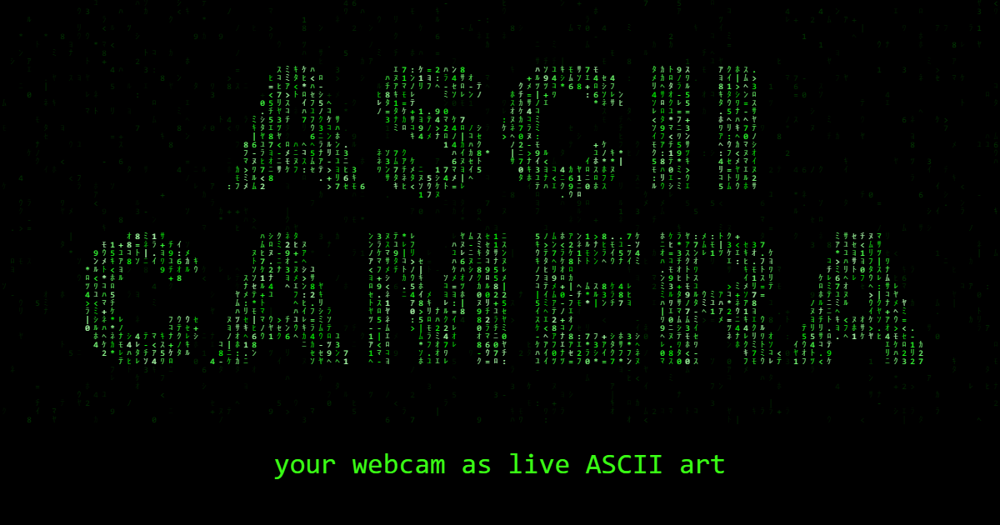

# ASCII Webcam



[](LICENSE)
[](https://vite.dev/)
[](https://ai.google.dev/edge/mediapipe/solutions/guide)

**Live ASCII art of your face, straight from your webcam.** Real-time face tracking cuts you out
of the background and shades your face in 3D, then redraws every frame as characters on black.
Built to be captured in OBS and streamed on Twitch, and runs entirely in the browser.

> 🔒 **Private by design:** no server, no uploads. Your camera feed never leaves your device.

## Features

- **Real face tracking.** [MediaPipe Face Landmarker](https://ai.google.dev/edge/mediapipe/solutions/vision/face_landmarker) follows 478 points on your face.
- **Background removal.** A selfie segmenter keeps your face, hair, neck and clothes, and blacks out the rest.
- **3D face shading.** The depth of the face points brightens what's close to the camera and darkens what's far, so eyes, brows and lips stand out.
- **5 symbol styles.** Matrix, binary, classic, detailed and blocks.
- **8 color themes,** including an animated rainbow.
- **Live controls.** Zoom, contrast, brightness, 3D depth and character size, from a drop-down panel or the keyboard.
- **Selfies.** Save the current frame as a PNG with one key or tap.
- **Efficient.** Face tracking runs only when something moves, and an FPS counter is one key away.
- **Works on phones.** Front camera, touch-friendly panel, fits any screen.

## Quick start

**Requirements:** [Node.js](https://nodejs.org/) 20+, a webcam, and `curl` (built into Windows 10+, macOS and most Linux distros).

```sh
npm install       # also copies MediaPipe's WASM runtime into public/wasm/
npm run model     # downloads the face and segmentation models (~4 MB) into public/models/
npm run dev
```

Open the URL it prints (usually http://localhost:5173) and allow camera access.

## Controls

Open the **⚙ Settings** tab at the top of the screen, or use the keyboard:

| Key       | Action                                  |
| --------- | --------------------------------------- |
| `P`       | Open / close settings                   |
| `H`       | Hide all controls (for streaming)       |
| `S`       | Next symbol style (`Shift`: previous)   |
| `C`       | Next color (`Shift`: previous)          |
| `+` / `-` | Zoom in / out                           |
| `[` / `]` | Contrast                                |
| `,` / `.` | Brightness                              |
| `F`       | Fullscreen                              |
| `Space`   | Take a selfie (saves a PNG)             |
| `I`       | Show / hide FPS                         |

Default values, slider ranges, symbol sets and colors all live in [`src/config.js`](src/config.js).

## Streaming with OBS

1. Run the app and open it in its own browser window.
2. Press `H` to hide the controls.
3. In OBS, add a **Window Capture** source and pick that window.
4. Don't add your webcam to OBS as well. On Windows, only one app can use the camera at a time.

## How it works

Each frame goes through the same steps:

1. **Motion check.** The frame is compared with the last processed one at 32×24. If nothing moved, the previous results are reused.
2. **Detection.** MediaPipe finds the face points and a mask of where you are in the frame.
3. **Masking.** Pixels that aren't you become transparent, so black hair stays visible while the background drops out.
4. **Sampling.** The frame is shrunk to one pixel per character and mirrored like a selfie.
5. **Brightness.** Each cell's brightness is adjusted for contrast, then shaded by the depth of the nearest face point, with extra contrast around the eyes, brows and lips.
6. **Drawing.** Every cell becomes a character in the chosen style and color.

## Scripts

| Script            | Description                                           |
| ----------------- | ----------------------------------------------------- |
| `npm run dev`     | Start the dev server with live reload                 |
| `npm run build`   | Build the production site into `dist/`                |
| `npm run preview` | Serve the built `dist/` folder locally                |
| `npm run model`   | Download the MediaPipe models into `public/models/`   |

## Project structure

```
index.html          entry page (loading screen, link preview tags)
src/main.js         bootstrap: camera + render loop
src/config.js       defaults and tunable values
src/settings.js     live settings (changed by the UI)
src/detection/      reads the camera: motion, face points, person mask
src/rendering/      turns the frame into characters (brightness.js: contrast + 3D face shading)
src/ui/             settings panel, keyboard shortcuts, selfie, FPS counter, status messages
src/styles/         page styles
public/             static files served as-is (favicon, preview image, models)
```

## Deployment

The app is fully static, so any static host works (Cloudflare Pages, Netlify, Vercel):

- **Build command:** `npm install && npm run model && npm run build`
- **Output folder:** `dist`

Camera access requires HTTPS, which these hosts provide.

## Tech stack

- [MediaPipe Tasks Vision](https://ai.google.dev/edge/mediapipe/solutions/guide) for face landmarks and selfie segmentation
- [Vite](https://vite.dev/) for the dev server and build
- Vanilla JavaScript and Canvas 2D, with no framework

## Author

<a href="https://www.linkedin.com/in/grigor-stoyanov-b5ab791aa/">
  
</a>

**Grigor Stoyanov**

[](https://www.linkedin.com/in/grigor-stoyanov-b5ab791aa/)

## License

Released under the [MIT License](LICENSE).
